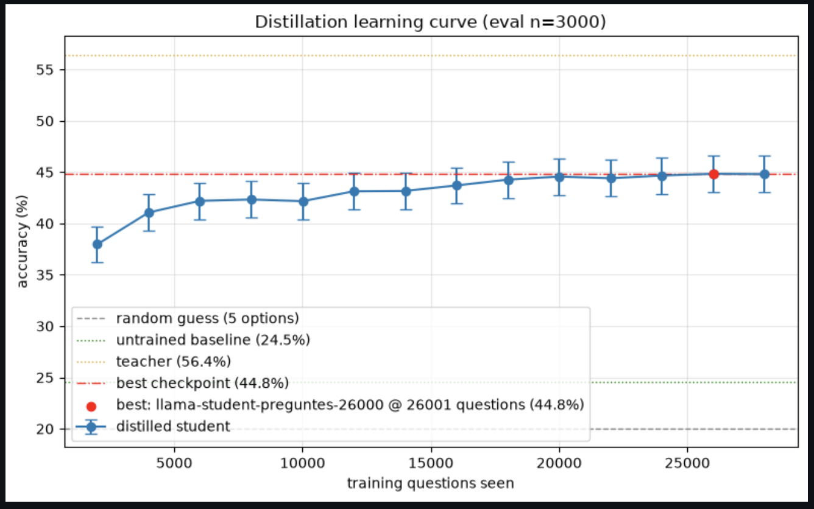

# "Can Medical Reasoning Be Compressed? Teaching Small Models to Think Clinically through Distillation" — Hochschule Heilbronn

This project consists of the code used to conduct experiment on **Knowledge Distillation** from a larger *teacher model* `OpenBioLLM` which is fine tuned for medical domain into a smaller *student model* - `Meta-llama` while preserving the medical knowledge. The trained student model is trained and tested for accuracy on the translated German Staatsexamen Questions.

## Authors
- Alexia Lozano
- Pratik Manandhar

## Project Specifications
- Teacher Model: [aaditya/OpenBioLLM-Llama3-8B](https://huggingface.co/aaditya/Llama3-OpenBioLLM-8B) - A fine-tuned, 8 billion parameter, open source language model designed for medical domain
- Student Model: [meta-llama/Llama-3.2-1B-Instruct](https://huggingface.co/meta-llama/Llama-3.2-1B-Instruct) & [meta-llama/Llama-3.2-1B-Instruct](https://huggingface.co/meta-llama/Llama-3.2-1B-Instruct) - An instruction-tuned large language model with 1 billion parameters
- GPU: A100 GPU cluster

## Contents
1. **Knowledge_Distillation.ipynb**: Jupyter notebook containing the knowledge distillation and evaluation process.
2. **Staatsexamen_dataset.csv**: The German Staatsexamen (English traslated) questions and answers dataset  used for training the student model
2. **medical_qna_1000.csv**: Additional 1000 generic medical domain questions for further evaluation of performance

## Training Process
- Shared prompt formatting (MCQ parsing, One-shot prompting)
- Loading Staatsexamen dataset 
- Loading Teacher and student model from HuggingFace
- Knowledge-distillation trainer (logits-based KD (Kullback-Lieler divergence loss + Cross entropy loss) + SFT-on-teacher-output approach)
- Hyperparameters and training (LoRA via PEFT, SFTTrainer/TRL)
- Merging LoRA checkpoints into standalone models
- Evaluation: Staatsexamen accuracy, generic medical QA (1000 LLM-generated questions), and Conversational Capability check of the distilled student model.

## 6. Setup / Requirements
- Required packages:
`torch`, `transformers`, `peft`, `trl`, `bitsandbytes`, `datasets`, `pandas`, `numpy`, `scikit-learn`, `huggingface_hub`
- Hugging Face token with access to the teacher and student models
- CUDA GPU

## 7. Usage
- Open `Knowledge_Distillation.ipynb`
- Set `TRAIN_STUDENT = True/False` and `MODEL` at the top to control whether training runs or only evaluation does.
- Change the `TEACHER_MODEL` and `STUDENT_MODEL` values to change the teacher or the student

## 8. Results
With a successful training of the student model over 3 epochs, the student model starts to plateau around 20000 questions and produces a maximum accuracy of 44.8% over all the saved training checkpoints. 

